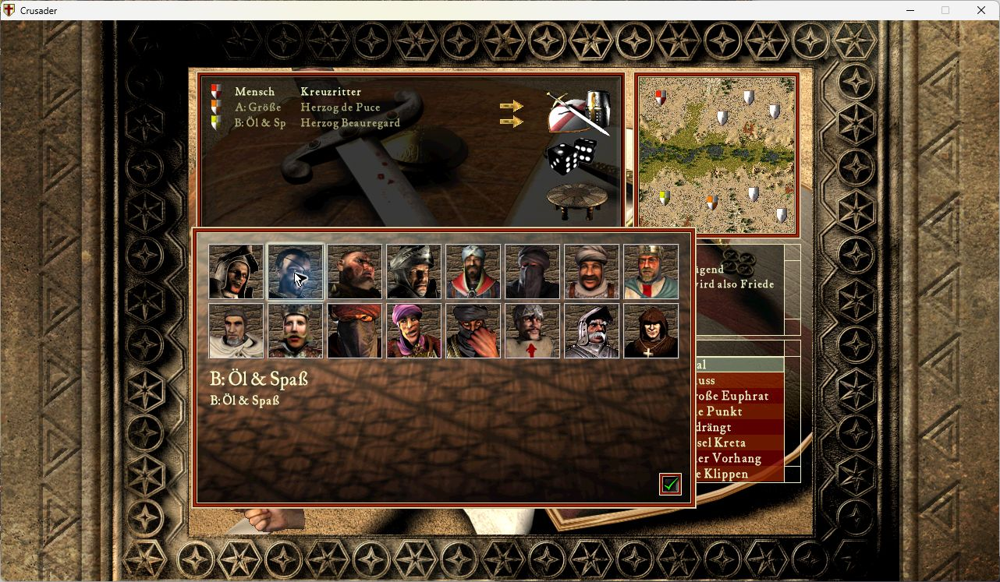
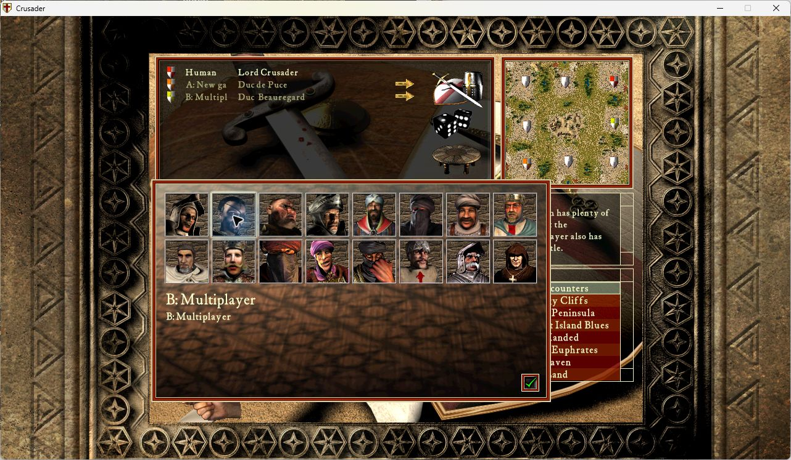
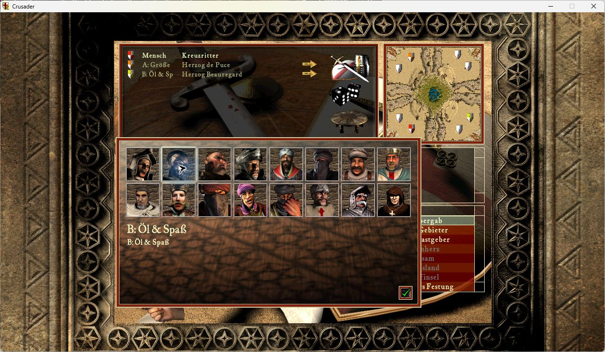
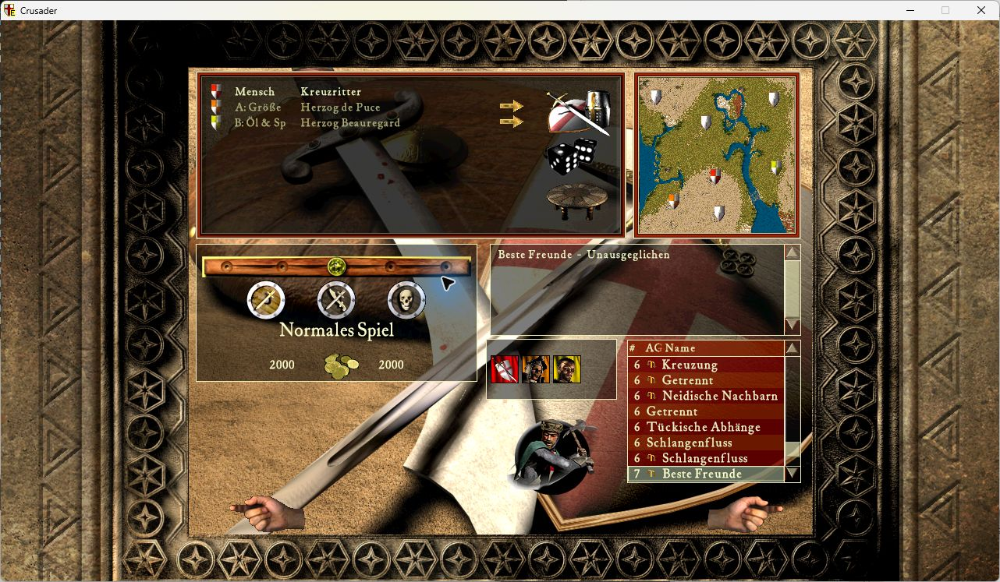

# R042 validation, 2026-09-10

The existing per-entry API already composes independent edits. This change fixes
UTF-8 source retention on repeated initialization and prevents `TransformText`
from selecting the Windows system codepage while the game codepage is zero.
It does not implement the JSON loader proposed in issue #4.

## Host regression

Windows x86, MSVC 19.44.35228, Windows SDK 10.0.26100, real Lua 5.4.6 and Windows
conversion APIs; production `textResourceModifier.cpp` is compiled into the host.
The native manager, loader/fallback and framework logging are stand-ins.

| Case | Unchanged 5ab58fa | Fixed implementation |
| --- | --- | --- |
| Disjoint entries, groups, both conflict orders, removal, empty/long text, Lua compatibility | Pass | Pass |
| Second initialization of `Größe für Öl %s` | Fails byte equality at check 3 | Pass, including ten repetitions |
| `TransformText` after initialization with codepage zero | Returns system-encoded text | Existing not-loaded error |
| Late registration, changed encoding, failed conversion, recovery from unavailable encoding | Covered by regression | Pass |
| Nine locale samples across CP1252/1250/1251/1254/936/1256 | No baseline claim | Pass |

The zero-codepage assertion was also run before adding its guard and failed at
reload check 18. Final CTest results: composition 33 checks, reload 22, encodings
27; all three suites pass. The Release project builds with the existing Lua
5.4.6 and UCP 3.0.7 dependencies; existing Lua integer-narrowing warnings remain.
All nine exported names and signatures remain unchanged.

## Native acceptance

Captured directly from the Windows game window in an isolated licensed install
on GamerGrill. Images are unedited window captures, 1282x747 including chrome,
with a 1280x720 game viewport. This is not a Windows DPI/scaling matrix.

Framework: UCP 3.0.7 Developer, release 77c6accf14. Renderer prerequisites:
winProcHandler 0.2.0 and graphicsApiReplacer 1.3.0. The original renderer crashed
in native texture drawing even with the baseline module on this machine.

| Run | Result |
| --- | --- |
| Released textResourceModifier 0.3.0, SHC 1.41, English | Startup API fixture passes |
| Released 0.3.0, SHC 1.41, German, disjoint A/B | 13 startup checks pass; both names/descriptions display accents |
| Rebuilt 0.3.1, SHC 1.41, German, conflicting A/B | 13 startup checks pass; B wins visibly; new match, save/load and return to setup preserve B |
| Final DLL, SHC 1.41, English, disjoint A/B and consumers | 18 startup checks pass; both names/descriptions visible |
| Final DLL, Extreme 1.41.1-E, German, disjoint A/B and consumers | 18 startup checks pass; accents visible; new match, save/load, restart and return to setup retain both overrides |

All native fixture orders above are A then B; both conflict call orders are
covered in the host. API checks include actual game language (`American` or
`German`), encoded bytes, late writes, native restoration, empty/long UTF-8 and
placeholders. Fixtures choose content to match an unmodified native `cr.tex`;
the module does not translate strings or select a language catalog.

Consumer runs enable released AI Swapper 1.1.0, gmResourceModifier 0.2.0,
files 1.3.0, aicloader 1.1.2, aivloader 1.0.0 and Legacy 2.15.1 with **only
`o_keys.enabled=true`**. The real configured AI Swapper callback writes localized
Snake text and clears an early override for an omitted title. A subsequent nil
clear confirms the value already matches native lookup. Inactive startup
options intentionally skip reset and are not a reset test.

The current local AI Swapper Lua scripts also pass name/title/description,
explicit reset and missing-locale file fallback checks with mocked SetText/JSON.
Its direct exported API has a separate proxy-call incompatibility tracked in
[AI Swapper #17](https://github.com/UnofficialCrusaderPatch/extension-aiSwapper/issues/17).
That issue is not fixed by this PR. aicloader has no direct text registrations;
the audited Legacy source has no overlapping text hook. This is not blanket
Legacy-option or current-AI-Swapper-version native compatibility.

### Visible evidence

Before: released 0.3.0, German disjoint entries already compose correctly.

After: final DLL, English, both packs remain present; B's full name and
description display in the picker.

After: final DLL, German Extreme, `Größe` and `Öl & Spaß` remain correctly
encoded. The small player-list column clips long names in both baseline and
fixed versions; the picker displays them fully. No layout behavior changed.

After Extreme save/load and mission restart, both entries remain in setup.

## Artifact identity and costs

SHA256 values:

| Artifact | SHA256 |
| --- | --- |
| SHC 1.41 executable | `3bb0a8c1e72331b3a30a5aa93ed94beca0081b476b04c1960e26d5b45387ac5a` |
| Extreme 1.41.1-E executable | `55648e6b05d67d37a5773fe699bbb17a2d6ad4de1bb9dbded9a21caef82bd7fb` |
| English cr.tex | `ab423bec4dab75595f9568564137584e72189bc0c95851abfe54058aa2f2ff68` |
| German cr.tex | `6716ffe38391012f04ce32017eb65e52eeddbeb4acc76268d726786c8bfb9dc3` |
| Released 0.3.0 module archive | `3b939f23f72c8bb190908ff29ba8a5af3d0a62626407624e929d498bb6b1a6ad` |
| Earlier German SHC conflict/save test DLL | `1b19ad6fbf9489c825b7c6336c2b5be014c8f0aebbaddf67836390d0365b9582` |
| Final tested DLL, including TransformText guard | `833ce3dfbf126e0f3c40459cc97b6f73bdeaefb5921e2505495bf0c947653ea1` |

Same-toolchain baseline DLL: 24,576 bytes; fixed DLL: 24,064 bytes. No dependency
added. Per-entry storage adds original UTF-8 and one string object. Before the
additional TransformText guard, five-run host medians were 2807 to 3680 us for
10,000 registrations and 13531 to 14617 us for 1,000,000 lookups. These coarse
synthetic timings are not native startup measurements; the lookup path retains
the same map lookup. The guard does not participate in that benchmark.

The installable developer package contains only DLL, init.lua, definition and
nine descriptions; fixtures, tests and screenshots are excluded. It is not a
signed release. Final package hash and source head are recorded in the PR.

## Limits and review gates

There is no observed natural second `cr.tex` load in these save/load/restart
flows. Repeated-loader correctness is established by invoking the production
interceptor in the host, not by claiming native reload reachability. No dynamic
disable, layered ownership or live language switching contract is added.

Descriptions cover all nine maintained GUI locales. UTF-8 files and catalog
identifiers are checked; human translation review remains requested. Codec
tests do not prove fonts, shaping, RTL layout or native game language assets
outside English/German. No MP/replay acceptance is claimed. No necessary
faithful OpenSHC reconstruction prerequisite was identified.

CI and maintainer review must be evaluated on the PR head separately from these
local results. This report does not assert that the PR has merged.
